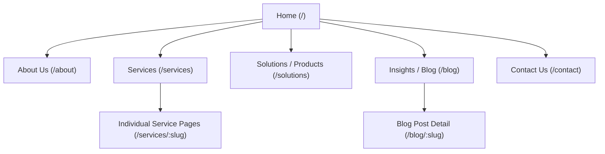

# Kenenet Website Sitemap & Information Architecture

## 1. Information Architecture Overview

---

## 2. Page Hierarchy & URL Structure

| Page Name | Route / URL | Primary Purpose | Key Content Blocks |
| :--- | :--- | :--- | :--- |
| **Home** | `/` | Brand introduction & value proposition | Hero, Value Props, Featured Services, Trust Badges, Testimonials, CTA |
| **About Us** | `/about` | Company background, story & credibility | Company Story, Mission & Vision, Leadership/Founder Bio, Milestones |
| **Services** | `/services` | Overview of core service offerings | Service Grid, Process / Methodology, Case Studies, Consultation CTA |
| **Service Detail** | `/services/[slug]` | In-depth breakdown of a specific service | Scope of Work, Deliverables, Tech Stack, FAQs, Booking Form |
| **Contact Us** | `/contact` | Lead generation & direct communications | Contact Form, Interactive Map, Office Locations, Email & Phone |
| **Privacy Policy** | `/privacy` | Legal compliance | Data handling, Cookies policy, User rights |
| **Terms of Service** | `/terms` | Legal compliance | Terms of website use, intellectual property |

---

## 3. Global Navigation Matrix

### Header Navigation
- **Logo** -> Links to `/`
- **Main Nav Items**:
  - Services (with dropdown if applicable)
  - About Us
  - Contact Us
- **Header Action Button**: `Get in Touch` / `Request a Quote`

### Footer Navigation
- **Column 1 (Company)**: Logo, short bio, social media icons, copyright notice.
- **Column 2 (Navigation)**: Home, About Us, Services, Contact.
- **Column 3 (Services)**: Direct links to primary service offerings.
- **Column 4 (Legal & Contact)**: Privacy Policy, Terms of Service, Support Email, Phone Number.

